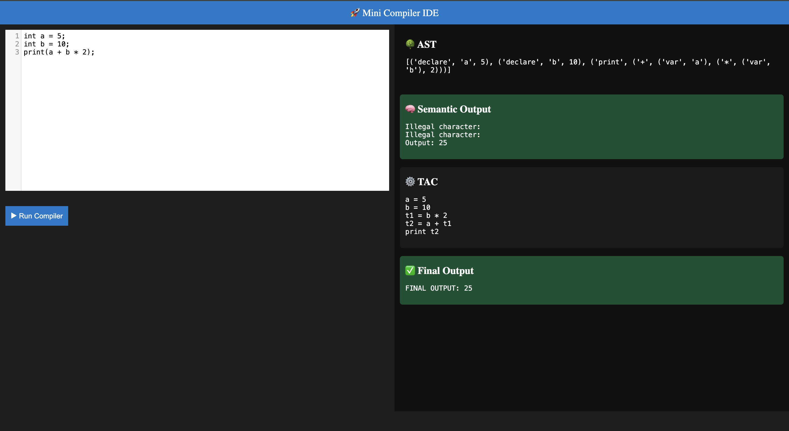
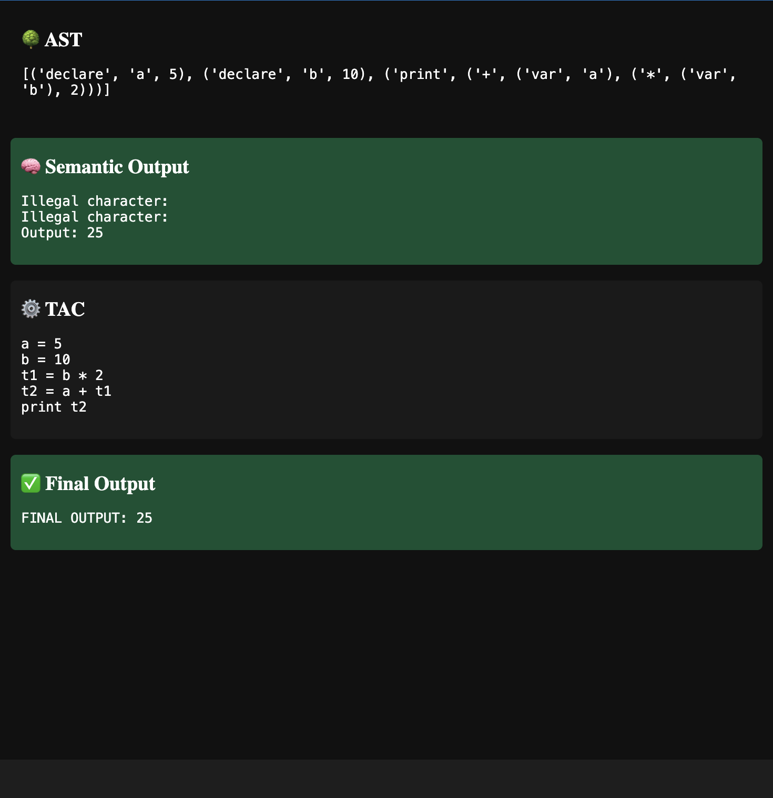

# Mini Compiler with Web IDE

A Python-based educational compiler that demonstrates the fundamental stages of compiler design, from lexical analysis and syntax parsing to semantic analysis, intermediate code generation, and program execution.

The project includes a browser-based code editor that allows users to write programs in a simple custom language and visualize the different stages of compilation.

## Overview

This project implements a simplified compiler using Python and PLY (Python Lex-Yacc). It processes source code through multiple compiler phases and executes the generated intermediate representation.

It provides two ways to interact with the compiler:

- **Web IDE:** Write and execute programs through a browser-based interface.
- **Command-Line Interface:** Run sample programs directly from the terminal.

## Key Features

- **Lexical Analysis:** Identifies keywords, identifiers, numbers, and operators using PLY.
- **Syntax Analysis:** Parses source code according to the language grammar.
- **Abstract Syntax Tree (AST):** Generates a structured representation of the source program.
- **Semantic Analysis:** Maintains a symbol table and detects undeclared variables and division-by-zero errors.
- **Intermediate Code Generation:** Converts expressions into Three Address Code (TAC).
- **Code Execution:** Executes the generated intermediate code using a custom interpreter.
- **Web-Based IDE:** Provides an interactive editor with compilation results.
- **Command-Line Execution:** Supports running programs directly through Python.

## Compiler Architecture

The compiler follows a sequence of processing stages:

```text
       Source Code
            |
            v
     Lexical Analysis
            |
            v
      Syntax Analysis
            |
            v
     Abstract Syntax Tree
            |
            v
     Semantic Analysis
            |
            v
 Intermediate Code Generation
            |
            v
  Three Address Code (TAC)
            |
            v
      Custom Interpreter
            |
            v
       Final Output
```

## Supported Language Features

The compiler currently supports:

| Feature | Description |
|---|---|
| Integer declarations | Declare integer variables |
| Print statements | Display expression results |
| Arithmetic addition | `+` |
| Arithmetic subtraction | `-` |
| Arithmetic multiplication | `*` |
| Arithmetic division | `/` |
| Parentheses | Control expression grouping |
| Operator precedence | Handles arithmetic precedence |

### Example Program

```c
int a = 5;
int b = 10;
print(a + b * 2);
```

Expected output:

```text
25
```

## Technology Stack

| Technology | Purpose |
|---|---|
| Python | Core compiler implementation |
| PLY | Lexical analysis and parsing |
| Flask | Backend for the web IDE |
| HTML and CSS | User interface |
| CodeMirror | Browser-based code editor |

## Project Structure

```text
Mini-Compiler-Web-IDE/
│
├── app.py                 # Flask web application
├── lexer.py               # Lexical analyzer
├── parser.py              # Syntax analyzer and AST
├── semantic.py            # Semantic analysis
├── intermediate.py        # Three Address Code generator
├── interpreter.py         # Intermediate code interpreter
├── main.py                # Command-line compiler
├── ui.py                  # Additional user interface
├── test_program.txt       # Sample source program
├── requirements.txt       # Python dependencies
├── README.md              # Project documentation
└── .gitignore              # Git ignore configuration
```

## Installation and Setup

### 1. Clone the Repository

```bash
git clone https://github.com/divy000/Mini-Compiler-Web-IDE.git
```

### 2. Navigate to the Project Directory

```bash
cd Mini-Compiler-Web-IDE
```

### 3. Create a Virtual Environment

```bash
python3 -m venv venv
```

### 4. Activate the Virtual Environment

For macOS and Linux:

```bash
source venv/bin/activate
```

### 5. Install Dependencies

```bash
pip install -r requirements.txt
```

## Running the Application

### Option 1: Run the Web IDE

Start the Flask application:

```bash
python app.py
```

Open your browser and navigate to:

http://127.0.0.1:5000

Write your program in the editor and use the Run Compiler button to execute it and view the compilation results.

### Option 2: Run Through the Command Line

```bash
python main.py
```

This executes the sample program from `test_program.txt` and displays the compiler stages and final output in the terminal.

## Learning Objectives

This project was developed to explore and implement core concepts of compiler construction, including:

- Design of lexical analyzers and context-free grammars.
- Construction and processing of Abstract Syntax Trees.
- Symbol tables and semantic validation.
- Intermediate representation using Three Address Code.
- Interpretation and execution of intermediate code.
- Integration of compiler components with a Flask-based web application.

## Future Improvements

- Improved syntax and semantic error reporting with line and column information.
- Support for additional data types and language constructs.
- Conditional statements and looping constructs.
- More comprehensive compiler test cases.
- Enhanced web IDE interface and compilation visualisation.


## Screenshots

### 1. Web IDE



### 2. Compiler Output




## Author

**Divyanshu Singh Parihar**

B.Tech Computer Science and Engineering

GitHub: [@divy000](https://github.com/divy000)

---

*An academic project exploring the fundamental principles of compiler design and implementation.*